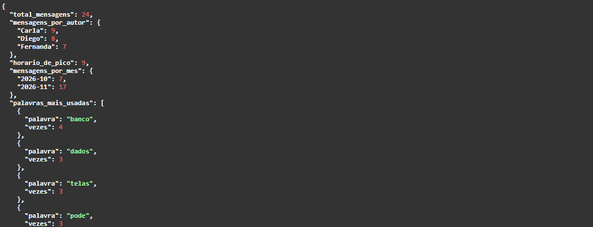
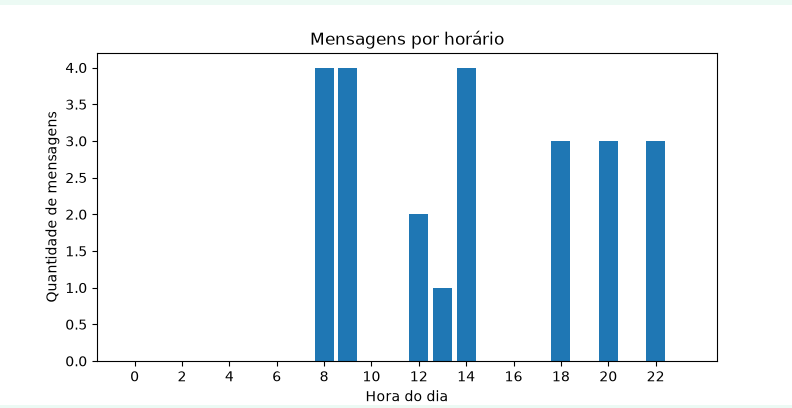

# WhatsApp Analyzer

API em Python (FastAPI) que recebe uma conversa exportada do WhatsApp (`.txt`) e devolve estatísticas e um gráfico.

> Nenhum dado é salvo: o arquivo é processado na hora e descartado.

## Demonstração

### Resposta da API


### Gráfico de mensagens por horário


## O que ela faz

- Conta mensagens por pessoa
- Descobre o horário de pico
- Mostra mensagens por mês
- Lista as palavras mais usadas
- Gera um gráfico de mensagens por horário

## Tecnologias

Python, FastAPI, pandas, matplotlib, pytest

## Como rodar

```bash
python -m venv venv
venv\Scripts\activate          # Windows
pip install -r requirements.txt
uvicorn app.main:app --reload
```

Abra http://127.0.0.1:8000/docs para testar pela página automática da API.

## Endpoints

| Método | Rota | O que faz |
|---|---|---|
| GET | `/saude` | Confirma que a API está no ar |
| POST | `/analisar` | Recebe o `.txt` e devolve as estatísticas em JSON |
| POST | `/grafico/horarios` | Recebe o `.txt` e devolve um gráfico PNG |

## Exemplo de resposta (`/analisar`)

```json
{
  "total_mensagens": 13,
  "mensagens_por_autor": {"Ana": 7, "Bruno": 6},
  "horario_de_pico": 8,
  "mensagens_por_mes": {"2026-11": 13},
  "palavras_mais_usadas": [{"palavra": "aula", "vezes": 2}]
}
```

## Testes

```bash
pytest
```

## Estrutura

```
app/
  main.py      # a API e os endpoints
  parser.py    # lê o .txt e monta a tabela
  analise.py   # calcula as estatísticas
tests/
  test_parser.py
exemplos/
  conversa_teste.txt   # conversa fictícia
```

## Autora

Maria Eduarda Simoes Silva
