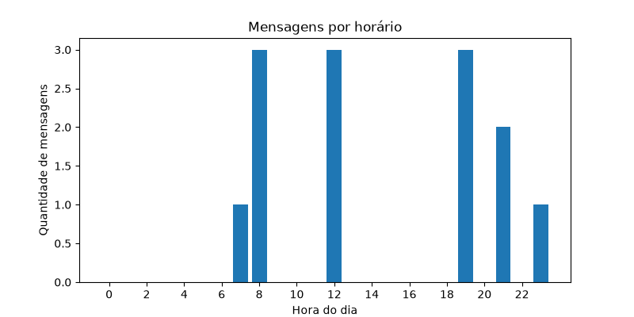

# WhatsApp Analyzer

Projeto desenvolvido em Python para analisar conversas exportadas do WhatsApp. A partir de um arquivo `.txt`, a API processa as mensagens e apresenta algumas informações sobre a conversa, como quantidade de mensagens por pessoa, horários de maior atividade e palavras mais utilizadas.

## Prévia

**Mensagens por horário**



## Funcionalidades

- Total de mensagens da conversa.
- Quantidade de mensagens enviadas por cada pessoa.
- Horário com maior número de mensagens.
- Histórico de mensagens por mês.
- Palavras mais utilizadas.
- Gráfico de mensagens por horário.

## Tecnologias

- Python
- FastAPI
- Pandas
- Matplotlib
- Pytest

## Executando o projeto

Clone o repositório:

```bash
git clone https://github.com/mariaeduarda-simoes/whatsapp-analyzer.git
cd whatsapp-analyzer
```

Crie o ambiente virtual e instale as dependências:

```bash
python -m venv venv
venv\Scripts\activate
pip install -r requirements.txt
```

Inicie a API:

```bash
uvicorn app.main:app --reload
```

Depois, acesse http://127.0.0.1:8000/docs para testar os endpoints.

## Rotas disponíveis

| Método | Rota | Descrição |
|---|---|---|
| GET | `/saude` | Verifica se a API está funcionando. |
| POST | `/analisar` | Analisa a conversa e retorna os resultados em JSON. |
| POST | `/grafico/horarios` | Gera um gráfico em PNG. |

## Exemplo de retorno

```json
{
  "total_mensagens": 13,
  "mensagens_por_autor": {
    "Ana": 7,
    "Bruno": 6
  },
  "horario_de_pico": 8,
  "mensagens_por_mes": {
    "2026-11": 13
  },
  "palavras_mais_usadas": [
    {
      "palavra": "aula",
      "vezes": 2
    }
  ]
}
```

## Testes

Os testes podem ser executados com:

```bash
pytest
```

## Estrutura dos arquivos

```text
app/
├── main.py
├── parser.py
└── analise.py

tests/
└── test_parser.py

exemplos/
└── conversa_teste.txt
```

## Sobre o projeto

O WhatsApp Analyzer foi desenvolvido como um projeto de estudo e prática com Python, processamento de arquivos e criação de APIs utilizando FastAPI.

Os arquivos enviados são processados durante a requisição e não ficam armazenados pela aplicação.

**Desenvolvido por Maria Eduarda Simoes Silva.**
